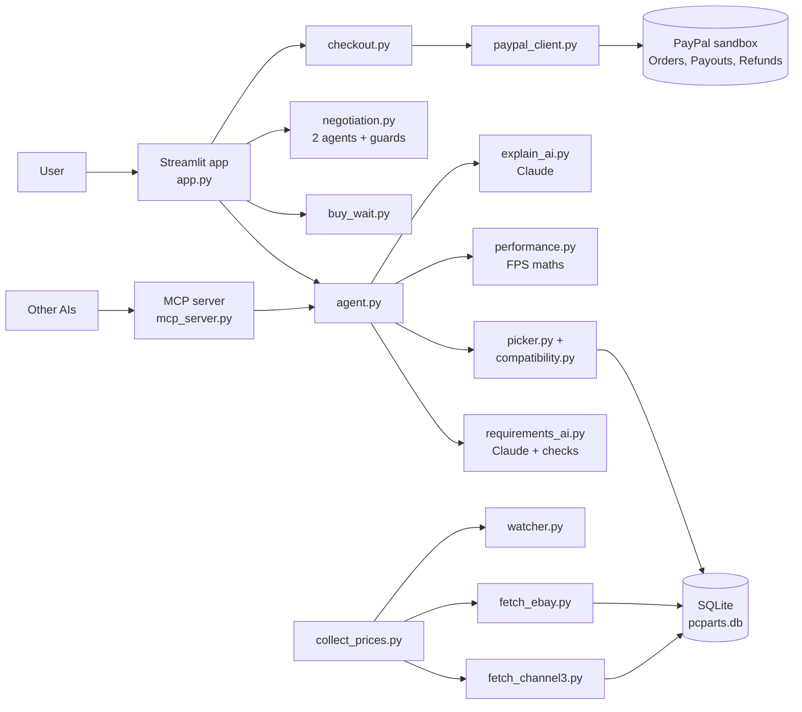

# RigAgent

**An AI agent that designs your PC, haggles for used parts, tells you whether to buy now or wait, and checks out every seller with one PayPal payment. Other AIs (Claude, ChatGPT) can use it too, through MCP.**

Built solo for the Devpost hackathon *Build What's Next with PayPal and AI*.

## The problem

Building a PC is confusing (parts that don't fit together), expensive, and timing matters (price drops, Black Friday). Used parts save money but mean haggling with strangers and trusting them. Buying from several shops means several checkouts. RigAgent is for first-time builders, students and gamers on a budget.

## What it does

1. **Tell it what you want** in plain English: budget, games, new or used, anything else ("I stream on Twitch").
2. **Claude turns that into hardware requirements** (it recognises games, even ones not in our table, and estimates how demanding they are). Python checks every number.
3. **The part picker** finds the cheapest compatible build that meets the requirements, then spends leftover budget on the upgrades that add the most performance per pound.
4. **8 compatibility rules** (socket, RAM type, PSU wattage, PSU size, GPU length, board size, cooler socket, cooler height) are checked by code, not AI.
5. **FPS estimates** for each of your games, with the bottleneck (CPU or GPU).
6. **Claude explains the build** using only facts the code worked out.
7. **Buy now / Fair / Wait** for every part: price trend (least-squares line over 30 days), position in the 90-day range, and a Black Friday rule, with a price chart.
8. **Haggling:** a buyer agent negotiates with each used seller's agent, live on screen. **Python guards** enforce your maximum price and the seller's floor, whatever the AI says.
9. **Approve, then one PayPal checkout pays every seller.** Shops are paid immediately; money for used parts is **held in escrow** until you confirm the part arrived working, or **refunded** if it didn't.
10. **Price watch:** for "Wait" parts, set a target price; when it's reached, RigAgent prepares the PayPal order so buying is one tap.
11. **MCP server:** other AIs can call `design_build`, `rate_timing`, `negotiate` and `create_checkout` (which only returns an approval link a human must click).

**Principle: AI for language and judgement, code for facts, money and safety.** Nothing is ever bought without the user approving it on PayPal's own page.

## How PayPal is used

| PayPal API | Where | What for |
|---|---|---|
| OAuth 2.0 client credentials | `paypal_client.py` | Access token (cached until it expires) |
| Orders v2: create, get, capture | `checkout.py` | One checkout for the whole build; order status tracking |
| Multiple purchase units with `payee` | `checkout.py` (split mode) | One purchase unit per seller, so PayPal pays each seller directly |
| Payouts | `checkout.py` (marketplace mode) | Pay each shop after capture; release escrow when the buyer confirms delivery |
| Refunds (captures) | `checkout.py` | Partial refund for a used part with a problem |
| `PayPal-Request-Id` idempotency keys | `paypal_client.py` | Safe retries: a page refresh can't capture or refund twice |

Two checkout modes (`PAYPAL_CHECKOUT_MODE`):

- **marketplace** (default): the buyer pays RigAgent once; RigAgent pays shops with Payouts and holds used-part money in escrow. Works with a normal sandbox app.
- **split**: one order with a purchase unit per seller (`payee.email_address`). PayPal documents multi-seller payments as a platform feature, so if your sandbox app isn't enabled for it, PayPal returns an error and you switch back to marketplace.

## How AI is used

| Job | File | How |
|---|---|---|
| Understand the user | `requirements_ai.py` | Claude returns structured JSON (a Pydantic schema): games with estimated demand, resolution, FPS target, RAM, storage. Python clamps every value. |
| Explain the build | `explain_ai.py` | Claude writes a short explanation from facts our code computed |
| Buy/wait advice | `buy_wait.py` | Code decides the rating; Claude writes the advice |
| Negotiation | `negotiation.py` | Buyer and seller agents (Claude, structured moves) with hard limits in Python |
| Other AIs | `mcp_server.py` | MCP tools over stdio (Claude Desktop) or HTTP |

Every AI call has an **offline fallback** (keyword rules, templates, scripted negotiators), so the app works with no API key and never breaks mid-demo.

## Architecture



### Files

| File | What it does |
|---|---|
| `app.py` | Streamlit web app (Design, Build, Haggle, Checkout, Orders, Price watch, About) |
| `agent.py` | The main pipeline shared by the app and MCP server |
| `config.py` | Reads every setting from `.env`; decides live vs offline for each service |
| `db.py` | Database connection; `python db.py` rebuilds it with 90 days of test price history |
| `schema.sql`, `seed.sql`, `queries.sql` | Database design, test catalogue (43 parts, 5 sellers), example queries |
| `compatibility.py` | The 8 compatibility rules |
| `picker.py` | "Minimum first, then upgrade" part picker |
| `performance.py` | Game demand table and FPS estimates |
| `ai_client.py` | Small wrapper around the Claude API with safe fallbacks |
| `requirements_ai.py`, `explain_ai.py` | The two core AI features |
| `buy_wait.py` | Buy/wait rating |
| `negotiation.py` | Buyer and seller agents |
| `paypal_client.py` | PayPal REST calls (plus `MockPayPal` for offline demos) |
| `checkout.py` | Multi-seller checkout, capture, escrow, refunds, order status |
| `watcher.py` | Price watch / auto-buy |
| `listings.py`, `fetch_channel3.py`, `fetch_ebay.py`, `collect_prices.py` | Real prices: match web listings to our parts and save them |
| `mcp_server.py` | MCP server |
| `tests/` | 23 tests (`python -m pytest`) |

## Run it locally

```bash
python3 -m venv .venv
source .venv/bin/activate
pip install -r requirements.txt
cp .env.example .env        # then fill in the keys you have (all optional)
python db.py                # build the database
streamlit run app.py        # opens http://localhost:8501
```

With no keys it runs fully offline: offline AI rules, test prices, and a mock PayPal checkout. Add keys to switch each part on; the sidebar shows what's live.

### PayPal sandbox setup

1. developer.paypal.com, Sandbox, **Apps & Credentials**: create an app; copy the Client ID and Secret into `.env`.
2. **Testing Tools, Sandbox Accounts**: create a personal (buyer) account and 3 to 5 business (seller) accounts. Put the business emails in `SELLER_1_EMAIL` ... `SELLER_5_EMAIL` and run `python db.py` again.
3. Run the app, build a PC, press **Approve and pay with PayPal**, and log in with the sandbox buyer account.
4. If PayPal holds GBP payments as "pending" because your sandbox accounts are US accounts, either create UK sandbox accounts or set `PAYPAL_CURRENCY=USD`.

### Use it from Claude Desktop (MCP)

Add this to `claude_desktop_config.json`, with your own paths, and restart Claude Desktop:

```json
{"mcpServers": {"rigagent": {"command": "/full/path/to/.venv/bin/python",
                             "args": ["/full/path/to/mcp_server.py"]}}}
```

Then ask: *"Use RigAgent to design a £1000 PC for Fortnite and give me a checkout link."*

### Fetch real prices

```bash
python explore_channel3.py           # look at one raw Channel3 response
python fetch_channel3.py "RTX 4070"  # try matching one part
python fetch_ebay.py "RTX 3060"      # used listings from eBay UK
python collect_prices.py             # everything, then check price watches
```

## Deploy on Render

Dashboard, **New, Blueprint**, pick this repo. `render.yaml` creates the web app and an HTTP MCP server, and asks for each secret. Set `APP_BASE_URL` to the app's Render URL so PayPal can send buyers back.

## Honest limits

- PayPal runs in the **sandbox** (test money). Sellers are sandbox business accounts standing in for real shops; the parts and prices come from Channel3 and eBay when keys are set, otherwise from the test catalogue.
- Seller negotiation agents are **simulated**, as a preview of agent-to-agent commerce.
- Benchmark scores and game demands are approximations for estimating, not lab measurements.
- Price watch prepares the order, but PayPal still asks the buyer to approve. Charging with no click would need a saved payment method (PayPal Vault), the next step after the hackathon.

## License

MIT
